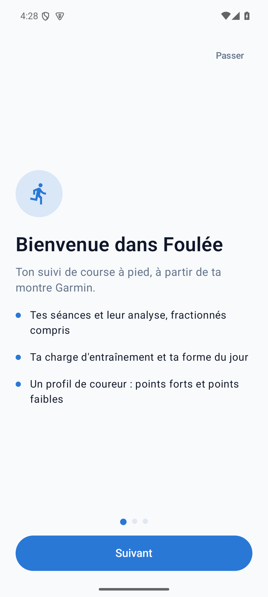
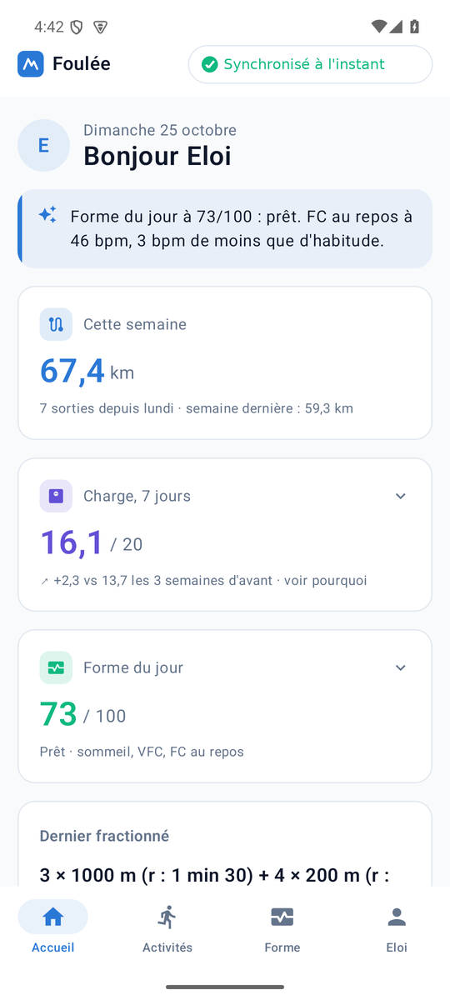
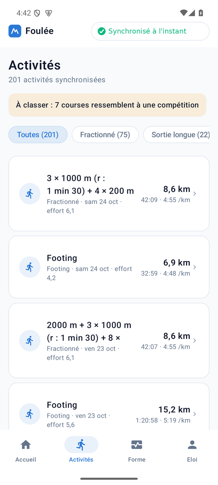
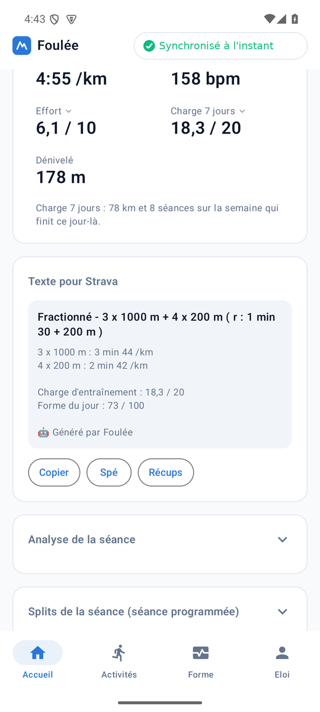
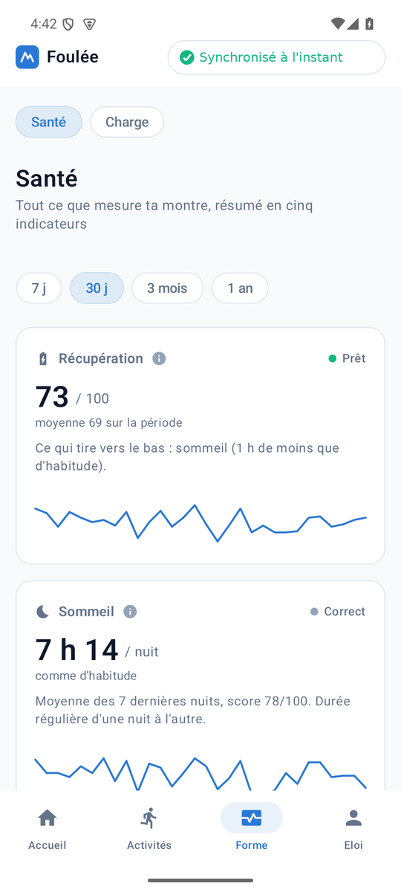
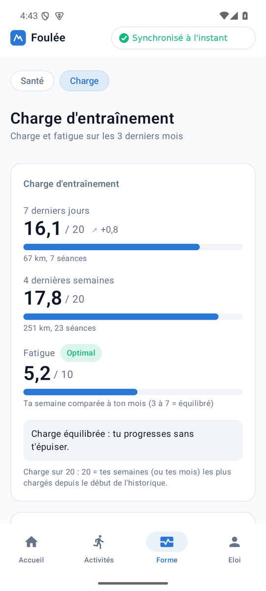
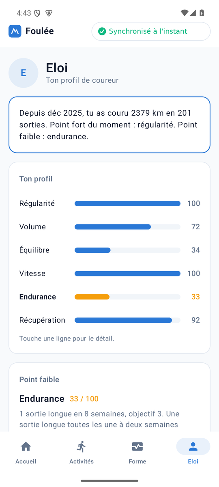
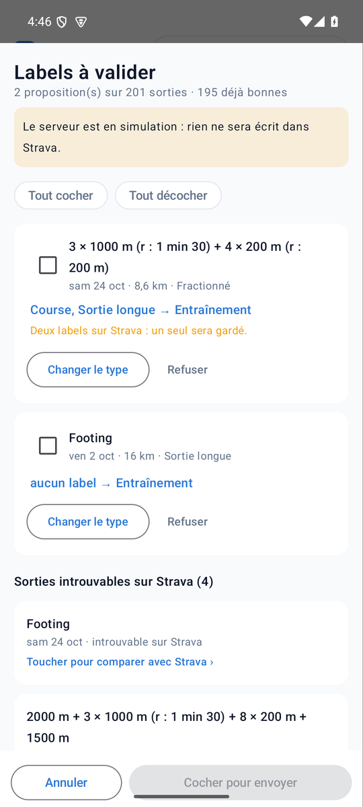

# Foulée

Application Android de suivi de course à pied à partir de Garmin Connect : séances et analyse des fractionnés, charge d'entraînement, forme du jour, profil de coureur, et une notification à chaque fin de course (distance, allure, forme du jour sur 100, fatigue sur 10). Tout tourne dans le téléphone, sans serveur Foulée. Un serveur Strava personnel est possible mais facultatif (voir plus bas).

## Aperçu

Captures faites sur émulateur avec des données fictives. Le bandeau de synchro y est retouché : l'émulateur n'a pas de vrais jetons Garmin, sa synchro échoue.

<p>
  
  
  
  
</p>
<p>
  
  
  
  
</p>

## Fonctionnement

- L'appli se connecte à Garmin Connect comme l'appli mobile Garmin (SSO, puis jetons OAuth, avec le code MFA si ton compte en a un). Le mot de passe n'est jamais conservé (il n'existe qu'en mémoire le temps de la connexion). Seuls les jetons de session sont gardés, chiffrés (AES-GCM, clé dans l'Android Keystore) dans le stockage privé de l'appli. Garmin n'a pas d'API publique pour les particuliers : cette connexion non officielle peut casser si Garmin la modifie.
- Un travail WorkManager vérifie Garmin toutes les 15 minutes (le minimum d'Android pour une tâche périodique). Pour chaque nouvelle course à pied, il envoie une notification. La notification arrive donc une fois la course synchronisée par la montre vers Garmin Connect, pas à l'instant où elle se termine.
- Au premier lancement, trois écrans présentent l'appli (balayage ou « Suivant ») avant la connexion à Garmin. Ensuite l'historique (jusqu'à 800 activités) et jusqu'à 365 jours de santé sont récupérés dans une base SQLite locale, en plusieurs synchros complètes d'affilée : à chaque synchro complète, les courbes, tracés et tours de 40 activités et les tours seuls de 120 activités plus anciennes sont aussi téléchargés. Les courses déjà présentes ne notifient pas. La synchro récupère les séances et les jours de santé en parallèle (quelques appels à la fois, avec nouvel essai si Garmin limite le débit), et le temps restant affiché vient de ce que la synchro a encore à faire et du rythme mesuré aux synchros précédentes.

## Interface

Même identité que l'ancienne web app : logo, bleu d'accent `#2a78d6`, cartes arrondies, thème clair ou sombre selon le téléphone, barre de quatre onglets en bas (Accueil, Activités, Forme, Utilisateur), pastille d'état de la synchro en haut de chaque écran.

- **Accueil** : salutation, phrase sur la forme, km de la semaine, charge sur 7 jours (avec le détail « ce qui fait la différence » par type de séance), forme du jour (facteur par facteur), carte « Dernier fractionné » avec le résumé de son analyse, courbe des 26 dernières semaines, activités récentes.
- **Activités** : liste filtrable par type de séance (fractionné, sortie longue, footing, musculation, compétition, autre), avec l'effort de chaque séance. Un bandeau mène à « À classer » : les courses qui ressemblent à une compétition d'après des règles simples, à confirmer ou non.
- **Fiche d'une activité** : distance, durée, allure, FC moyenne, effort, charge sur 7 jours (toucher une valeur ouvre une jauge avec son détail). Pour un fractionné : une carte « Texte pour Strava » (titre et description prêts à copier, voir plus bas), puis l'analyse écrite de la séance et les splits de la séance (allure et FC moyennes par type d'effort, détail des répétitions), repliés jusqu'à ce qu'on les ouvre. Ensuite carte OpenStreetMap sous le tracé GPS, courbes d'allure, de FC et d'altitude, effet d'entraînement (le « i » explique et donne aérobie, anaérobie, charge et zones cardio), temps par km et tours de la montre. Sur un fractionné, des pastilles isolent un type d'effort ou de récup (une séance peut en avoir plusieurs). Le type de séance se change à la main.
- **Forme** : deux vues. Santé : cinq indicateurs (récupération, sommeil, VFC, condition, fatigue) avec explication et échelle, sur 7 jours à un an, et toutes les données brutes de la montre (phases de sommeil, Body Battery, pas).
  Charge : charge 7 jours et 4 semaines, fatigue, courbes sur 90 jours, et « Forme selon Garmin » (VO2 max, statut d'entraînement, charge aiguë et chronique, prédictions de course).
- **Utilisateur** : ton profil de coureur (chiffres clés, points forts et points à surveiller calculés sur tes données : régularité, volume, répartition de l'intensité, VO2 max, FC au repos, VFC, sommeil), puis le serveur Strava (replié) et la synchro (repliée, elle s'ouvre toute seule pendant une synchro) : progression par étapes avec temps restant, jauge des données récupérées, vérification automatique des notifications et test, historique, réinitialisation.

## Strava (facultatif)

L'appli ne parle jamais à Strava directement. Elle peut échanger avec un serveur Strava personnel, relié à ton compte (adresse et clé à saisir dans l'onglet Utilisateur, section « Serveur Strava »). Sans adresse, aucune de ces fonctions n'apparaît. Pour mettre en place le serveur, contacter le développeur.

- **Labels** : « Analyser les labels » compare tes sorties à ce que l'appli détecte (compétition, entraînement, sortie longue) et affiche les propositions. Rien n'est envoyé sans ta validation : tu coches les sorties à modifier, tu peux changer le type proposé ou refuser. Une sortie n'a jamais deux labels.
- **Titre et description des fractionnés** : l'appli rédige un titre au format « Fractionné - 3 x 1000 m + 4 x 200 m ( r : 1 min 30 + 200 m ) » et une description (allure moyenne de chaque type d'effort, charge d'entraînement, forme du jour, signature « Généré par Foulée »). On peut les copier à la main depuis la fiche, ou laisser l'appli les envoyer pour les prochains fractionnés seulement (jamais l'historique). La spé (5 km, 10 km, semi, marathon) est proposée d'après l'allure, jamais appliquée sans toi. Le type de récup (au temps ou à la distance) est détecté d'après les tours de la montre et se corrige dans une fenêtre dédiée.
- Un serveur en simulation n'écrit rien dans Strava : l'appli l'indique avant chaque envoi.

## Calculs

Repris de l'ancien backend (voir l'historique git) :

- `Insights.kt` : la charge d'une séance est le Training Load Garmin, ou à défaut un TRIMP calculé sur la courbe de FC (ou sur la FC moyenne sans courbe). Fatigue (0 à 10) : charge des 7 derniers jours comparée à la semaine moyenne des 28 derniers jours. Forme du jour (0 à 100) : sommeil, score de sommeil, VFC, FC au repos, Body Battery et stress comparés à tes propres valeurs des 30 à 60 jours précédents, plus la fatigue de la veille.
- `Intervals.kt`, `Categories.kt` : détection des fractionnés à partir des tours de la montre, et type de séance.
- `SessionAnalysis.kt` : verdict d'une séance de fractionné par comparaison avec tes répétitions passées, fin de série, récupération cardiaque, contexte du jour et corrélations personnelles.
- `HealthSummary.kt`, `LoadCompare.kt`, `Review.kt` : indicateurs de santé, comparaison de charge par type, règles de « À classer ».

## Lancer sur ton téléphone

Prérequis : Node (pour `npm run`), Java 17 ou plus, `curl` et `unzip`. Sur le téléphone : activer le mode développeur, puis le débogage USB, et brancher en USB (accepter la demande d'autorisation à l'écran).

```bash
npm run android
```

Au premier lancement, le script télécharge le SDK Android (environ 1 Go, depuis dl.google.com dans `~/Android/Sdk`, ou `ANDROID_HOME` si défini) et Gradle, génère le wrapper Gradle, compile, installe l'appli sur le téléphone et l'ouvre. Ensuite, seule la compilation reste. Autres commandes : `npm run android:install` (sans ouvrir), `android:setup` (préparer seulement), `android:devices`, `android:logs`.

Dans l'appli, saisir l'e-mail et le mot de passe Garmin. Le bouton « Tester » envoie la notification de la dernière course. Android Studio fonctionne aussi : ouvrir le dossier `android/`.

## Structure

```
package.json, scripts/android.sh  commandes npm pour compiler et installer
android/app/src/main/java/fr/foulee/app/
  GarminAuth.kt, Http.kt, Secret.kt   connexion Garmin, jetons chiffrés
  Sync.kt, SyncEngine.kt              récupération des données, étapes, progression et temps restant
  Strava.kt, StravaText.kt, StravaTexts.kt   serveur Strava : labels, titres et descriptions
  NetworkDiagnostic.kt                diagnostic réseau vers le serveur Strava
  Db.kt, Settings.kt                  base SQLite et préférences
  Insights.kt, Intervals.kt, Categories.kt, SessionAnalysis.kt
  HealthSummary.kt, LoadCompare.kt, Review.kt, Splits.kt
  RunChecker.kt, RunCheckWorker.kt, Notifier.kt   notification de fin de course
  Profile.kt                          analyse du profil de coureur
  Theme.kt, Ui.kt, Screens.kt, Health.kt, Fitness.kt, SessionCard.kt, User.kt, SyncScreen.kt, ActivityDetail.kt, RouteMap.kt, Onboarding.kt, MainActivity.kt   interface
```
